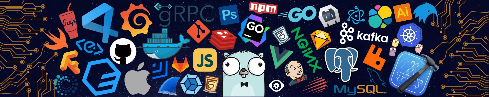

<h1>
  Hi there!
  
</h1>

<p align="center">
  <a href="https://github.com/thanhtan0501"></a>
  
  
</p>

<p align="center">
  <!-- Source: https://github.com/Aurorp1g/Aurorp1g/blob/main/footer.webp -->
  
</p>

##  About Me:

-  **I'm a Senior Software Engineer.**
- 💻 **I use daily:** `.ts`, `.sql`, `.sh`, React, Next.js, Node.js, and NestJS.
- ⚡ **Fun fact:** I started in frontend development before moving deeper into full-stack engineering and system design.
- 🎾 **Tennis:** My favorite way to spend time away from the keyboard.
- 💬 **Ping me about:** TypeScript, full-stack development, APIs, PostgreSQL, system design, and AI integrations.

##  Skills

<p align="center">
  
  
  
  
  
  
  
  
</p>
<p align="center">
  
  
  
  
  
  
  
  
</p>
<p align="center">
  
  
  
  
  
  
  
</p>

##  My GitHub Stats:

<p align="center">
  
</p>

<p align="center">
  
</p>

<!-- START_COMMIT_STATS -->
###  I'm Most Active in the Daytime 🌆

```text
🌞 Morning    4 commits  ████████░░░░░░░░░░░░░░░░░░░░  11.11 %
🌆 Daytime   14 commits  ████████████████████████████  38.89 %
🌃 Evening   10 commits  ████████████████████░░░░░░░░  27.78 %
🌙 Night      8 commits  ████████████████░░░░░░░░░░░░  22.22 %
```

###  I'm Most Productive on Saturday

```text
Monday       4 commits  ██████████████░░░░░░░░░░░░░░  11.11 %
Tuesday      4 commits  ██████████████░░░░░░░░░░░░░░  11.11 %
Wednesday    5 commits  ██████████████████░░░░░░░░░░  13.89 %
Thursday     4 commits  ██████████████░░░░░░░░░░░░░░  11.11 %
Friday       4 commits  ██████████████░░░░░░░░░░░░░░  11.11 %
Saturday     8 commits  ████████████████████████████  22.22 %
Sunday       7 commits  ████████████████████████░░░░  19.44 %
```
<!-- END_COMMIT_STATS -->

##  A Famous Fact/Quote:

> “A distributed system is one in which the failure of a computer you didn't even know existed can render your own computer unusable.”
>
> — Leslie Lamport

##  Here's a Pinch of Humour:

<p align="center">
  
</p>

##  Connect Me Via

<p align="center">
  <a href="https://www.linkedin.com/in/thanhtan0501"></a>
  <a href="https://www.instagram.com/btt.thanh_/"></a>
  <a href="https://github.com/thanhtan0501"></a>
</p>

<p align="center"><sub>Thanks for visiting my profile! Have a great day!</sub></p>
