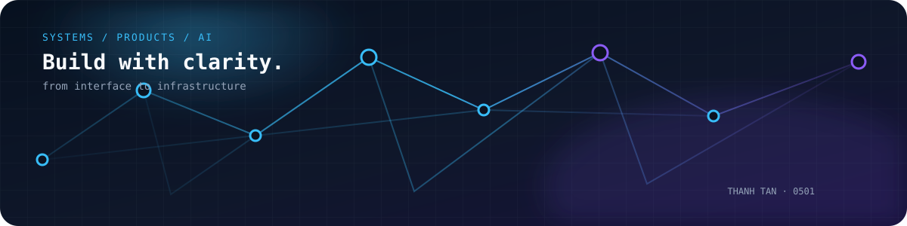

<h1>
  Hi there!
  
</h1>

<p align="center">
  <a href="https://github.com/thanhtan0501"></a>
  
  
</p>

<p align="center">
  <strong>Thanh Tan · Full-stack Software Engineer</strong><br />
  I design and build reliable products across interfaces, APIs, data, and infrastructure.
</p>

<p align="center">
  
</p>

##  About Me:

- 👋 I'm Thanh Tan, a Full-stack Software Engineer with approximately 6 years of professional experience.
- 🧩 I build web applications across frontend, backend, databases, and infrastructure.
- 💻 I work daily with TypeScript, JavaScript, React, Next.js, Node.js, NestJS, and PostgreSQL.
- 🏗️ I enjoy system design, architecture, security, distributed systems, and cloud engineering.
- 🤖 I'm exploring practical AI applications, LLM integrations, RAG, and developer tooling.
- 🛠️ I care about reliable systems, clean architecture, and maintainable software.

## Technology map

### Frontend

<a href="https://skillicons.dev"></a>

### Backend

<a href="https://skillicons.dev"></a>

### Data & caching

<a href="https://skillicons.dev"></a>

### Cloud & delivery

<a href="https://skillicons.dev"></a>

### Engineering & AI


## Selected public builds

These are public repositories owned by this account and verified through the GitHub API. Forks and mirrors are intentionally left out of this section.

| Project | What it shows |
| --- | --- |
| [TikTok Clone v2](https://github.com/thanhtan0501/--project-Tiktok-Clone-v2) | A Next.js / TypeScript product build with Appwrite integration and client-side media tooling. |
| [Spotify project](https://github.com/thanhtan0501/--project-spotify) | A Next.js / TypeScript interface build with reusable UI components and icon-driven navigation. |
| [Airbnb project](https://github.com/thanhtan0501/--project-airbnb) | A Next.js / TypeScript interface build using Tailwind CSS and Zustand for client state. |

##  My GitHub Stats:

<p align="center">
  
</p>

<!-- START_COMMIT_STATS -->
### I'm Most Active in the Daytime 🌆

> Based on 36 unique authored, non-merge commits from public, owned, non-fork repositories over a rolling five-year window. Commit author timestamps are converted to Asia/Ho_Chi_Minh (UTC+07:00).
> Time buckets: Night 00:00–05:59 · Morning 06:00–11:59 · Daytime 12:00–17:59 · Evening 18:00–23:59.

```text
🌞 Morning    4 commits  ████████░░░░░░░░░░░░░░░░░░░░  11.11 %
🌆 Daytime   14 commits  ████████████████████████████  38.89 %
🌃 Evening   10 commits  ████████████████████░░░░░░░░  27.78 %
🌙 Night      8 commits  ████████████████░░░░░░░░░░░░  22.22 %
```

### 📅 I'm Most Productive on Saturday

> Bars are scaled to the busiest category; percentages are the share of the same commit dataset.

```text
Monday       4 commits  ██████████████░░░░░░░░░░░░░░  11.11 %
Tuesday      4 commits  ██████████████░░░░░░░░░░░░░░  11.11 %
Wednesday    5 commits  ██████████████████░░░░░░░░░░  13.89 %
Thursday     4 commits  ██████████████░░░░░░░░░░░░░░  11.11 %
Friday       4 commits  ██████████████░░░░░░░░░░░░░░  11.11 %
Saturday     8 commits  ████████████████████████████  22.22 %
Sunday       7 commits  ████████████████████████░░░░  19.44 %
```
<!-- END_COMMIT_STATS -->

##  A Famous Fact/Quote:

> “A distributed system is one in which the failure of a computer you didn't even know existed can render your own computer unusable.”
>
> — Leslie Lamport

##  Here's a Pinch of Humour:

<p align="center">
  
</p>

## Connect

If you’re working on a product that needs careful full-stack engineering, architecture thinking, or practical AI integration, [connect with me on GitHub](https://github.com/thanhtan0501).

<p align="center">
  <a href="https://github.com/thanhtan0501"></a>
</p>

<p align="center">
  <sub>Built with GitHub-flavored Markdown, Skill Icons, Shields.io, Komarev, Streak Stats, and attributed open-source animation references.</sub>
</p>
